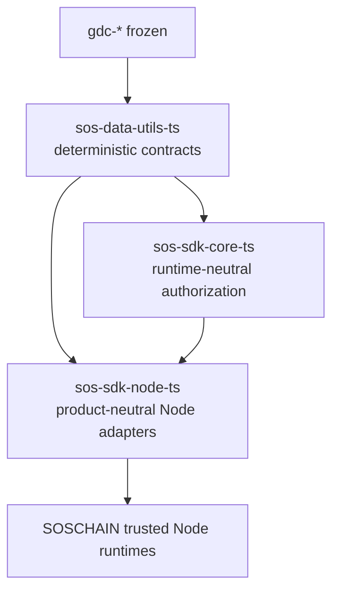

# Shared Node SDK boundary

`sos-sdk-node-ts` is the common Node-runtime layer; it is not the SOSChain
product SDK. Product-neutral storage, transport, credential, job and audio
adapters belong here. Sector policy remains in downstream applications, and no
shared package may depend back on a product SDK.

For immutable prompt audio, `sos-data-utils-ts/prompt-audio` produces the
canonical descriptor and localized numeric-code fragments. This package
hashes that exact descriptor, stores the resulting bytes durably and invokes
the configured provider only on a miss. Complete activation or verification
codes remain ICA state and are played by composing reusable digit assets.
